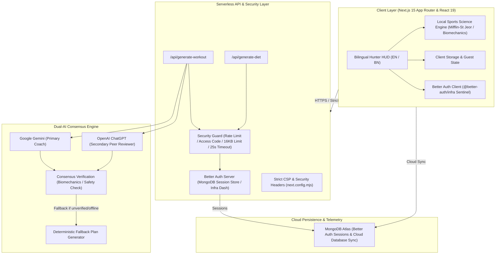

# ARISE: The System — Enterprise AI Sports Science & Hunter Progression Platform

[](https://nextjs.org/)
[](https://react.dev/)
[](https://www.typescriptlang.org/)
[](https://better-auth.com/)
[](https://mongodb.com/)
[](#accessibility)

**ARISE: The System** is a production-grade, bilingual (English & Bengali) athletic training, sports nutrition, and gamified RPG progression system modeled on the Solo Leveling hunter universe. It couples client-side deterministic biomechanics and exercise filtering with a dual-AI consensus architecture (Google Gemini + OpenAI ChatGPT) and an unshakeable offline fallback engine.

---

## 🏛️ System Architecture



---

## ✨ Key Features

1. **Dual-AI Consensus & Biomechanical Safety**:
   - Primary athletic generation orchestrated via **Google Gemini** with immediate secondary cross-verification by **OpenAI ChatGPT**.
   - If AI services are rate-limited, unreachable, or absent, the local deterministic engine produces compliant workout and nutrition plans instantly.
2. **Solo Leveling RPG Progression Engine**:
   - Complete hunter classification system (E-Rank to S-Rank, National Level).
   - Dynamic Level, EXP, Fatigue, HP/MP gauges, and 5-point attribute distribution (STR, AGI, VIT, INT, PER).
   - Milestone achievements, rank elevation ceremonies, and shadow army summons.
3. **Enterprise Security & Data Isolation**:
   - Cloud documents protected by user ID boundary verification.
   - Fail-fast environment variable validation via **Zod** (`lib/env.ts`).
   - Hardened HTTP headers: Strict Content Security Policy (CSP), `X-Frame-Options: DENY`, `X-Content-Type-Options: nosniff`, and `Strict-Transport-Security`.
4. **Resilient Cloud Sync with MongoDB Atlas**:
   - Real-time synchronization of profiles, workouts, goals, and evaluations with **MongoDB Atlas**.
   - Guest mode with automatic offline localStorage migration upon authentication.
5. **Full Internationalization (i18n)**:
   - High-fidelity English and Bengali (`bn`) localization across all screens, calculators, HUD elements, and voice cues.

---

## 🛠️ Environment Configuration

Copy the template to `.env.local`:

```bash
cp .env.example .env.local
```

### Required & Optional Variables

| Variable | Environment | Description |
| :--- | :--- | :--- |
| `BETTER_AUTH_SECRET` | Server | 32+ character cryptographic secret (`openssl rand -base64 32`) |
| `BETTER_AUTH_URL` | Server | Application base URL (`http://localhost:3000` or production domain) |
| `MONGODB_URI` | Server | MongoDB Atlas replica set URI for auth sessions & cloud sync |
| `MONGODB_DB_NAME` | Server | Database name (default: `fitness`) |
| `GEMINI_API_KEY` | Server | Google Gemini API key from [Google AI Studio](https://aistudio.google.com/apikey) |
| `OPENAI_API_KEY` | Server | OpenAI API key (optional secondary reviewer) |
| `ACCESS_CODE` | Server | Optional security access PIN to protect public deployments |

---

## 🚀 Local Development

```bash
# 1. Install dependencies
npm install

# 2. Start Next.js local development server
npm run dev

# 3. Access in browser
open http://localhost:3000
```

---

## 🧪 Testing & Verification

Every phase and release must pass the complete continuous integration verification suite:

```bash
# 1. Static TypeScript type checking
npm run typecheck

# 2. ESLint code hygiene and Best Practices audit
npm run lint

# 3. Vitest unit & integration test suite (61 tests)
npm run test

# 4. Database Row Level Security (RLS) compliance audit
npm run db:verify

# 5. Production bundle build
npm run build
```

---

## 🗄️ Database Migrations & RLS Verification

MongoDB Atlas collections and indexes can be initialized and seeded with 90+ exercises at any time:
```bash
npm run seed:mongo
```

---

## 🔒 Security Principles

- **Zero Hardcoded Secrets**: Secrets are validated strictly at runtime with Zod in `lib/env.ts`. No fallback keys exist in source code or Git history.
- **Defensive API Rate Limiting**: Tiered limits protect AI routes against resource exhaustion (Hunter: 20/hr, Access Code: 15/hr, Guest: 3/day).
- **Safe Timeouts & Payload Bounds**: AI generation calls are strictly bounded to 25 seconds with 16KB max payload checks.

---

## 📜 Medical & Sports Disclaimer

*ARISE: The System is an algorithmic and sports science educational guide, not a medical practitioner. Consult a qualified physician before starting any intense physical conditioning program.*
